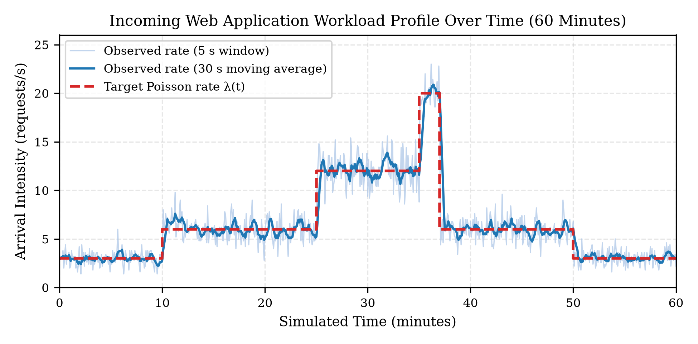
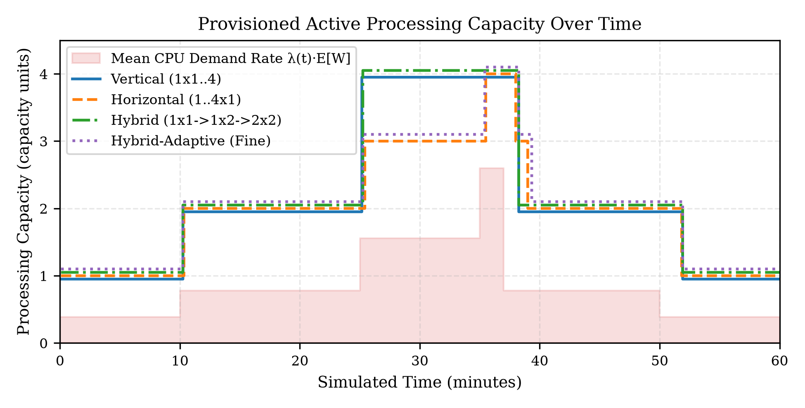
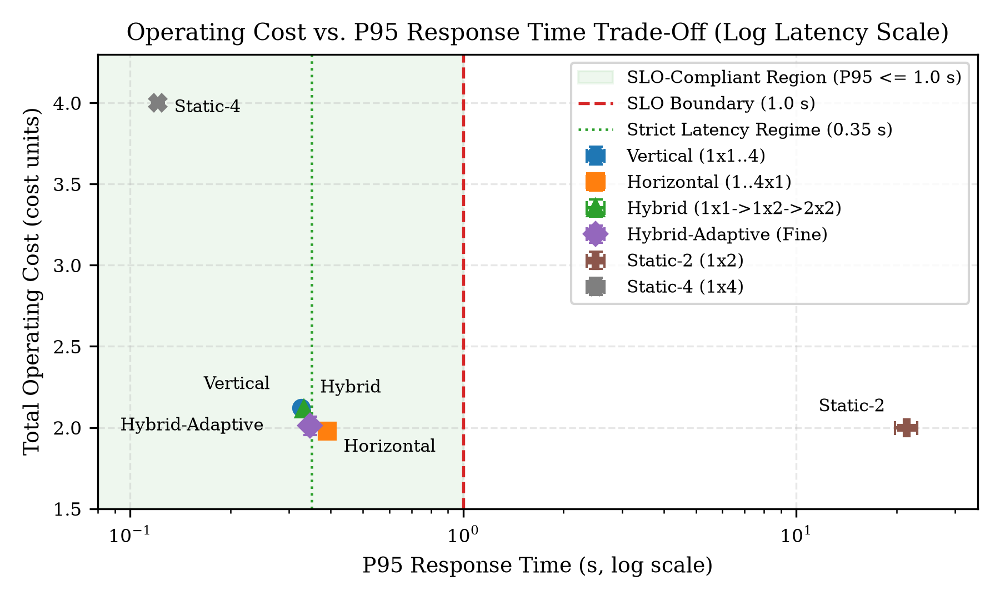
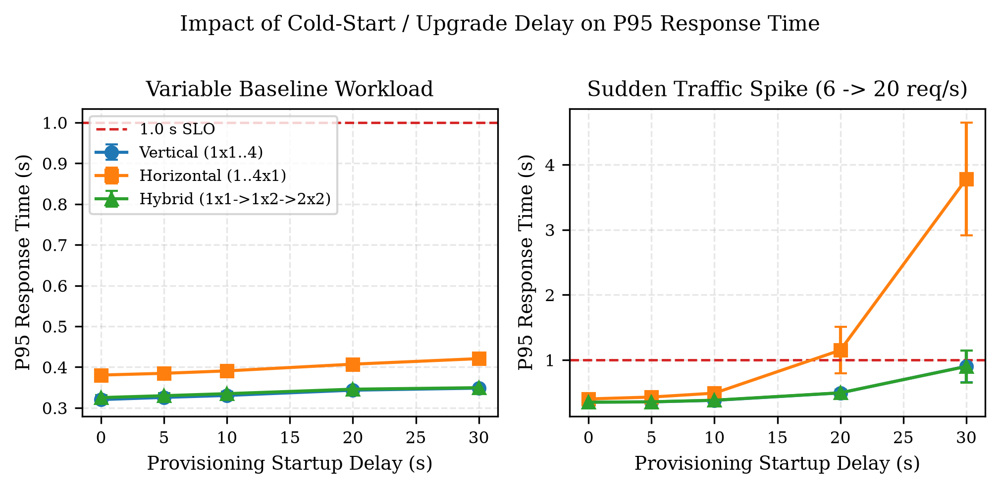
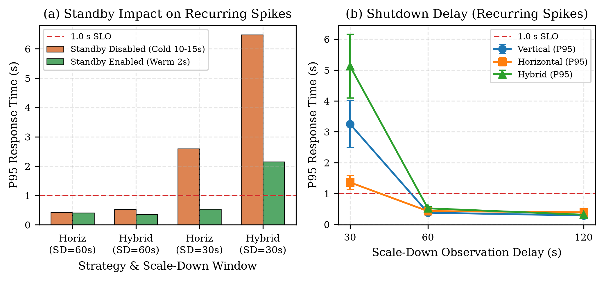

# Dynamic Server Scaling: Performance and Cost Trade-Offs of Vertical, Horizontal, and Hybrid Autoscaling Under Variable Workloads

**Shucayb Said**  
Department of Engineering Science, University West (*Högskolan Väst*)  
Trollhättan, Sweden  
*Course: DTA400 – Network Simulation (Autumn 2026)*  
*(Simulation software and experimental suite developed jointly with Firat Kaya; this manuscript is an independently written individual report by Shucayb Said.)*

---

## Abstract

Cloud-hosted web applications experience pronounced diurnal variations and sudden traffic spikes that make static server provisioning either prohibitively expensive or vulnerable to severe queue saturation. While reactive autoscaling mitigates this tension, cloud architects must choose between vertical scaling (resizing per-instance capacity), horizontal scaling (adding or removing server instances), and hybrid scaling (combining both dimensions). This paper presents a reproducible discrete-event simulation study built in Python and SimPy that evaluates vertical, horizontal, and two hybrid scaling strategies against single-server and multi-server static baselines across six stochastic traffic scenarios. The simulator models heterogeneous request classes (`small`, `medium`, `heavy`), centralized FIFO queuing, instance lifecycle states (`STOPPED`, `BOOTING`, `ACTIVE`, `DRAINING`, `STANDBY`), provisioning delays, post-horizon queue draining, and continuous-time normalized operating costs across $N = 10$ common-random-number seeds. Paired statistical evaluations show that under a standard service-level objective ($\text{P95} \le 1.0\text{ s}$), horizontal scaling achieves the lowest operating cost on variable baseline traffic ($1.9789\text{ units}$, $-6.78\%$ vs. vertical and $-6.48\%$ vs. 3-tier hybrid, both statistically significant at the 95% level) due to finer 1-unit capacity increments at intermediate loads. However, horizontal scaling suffers severe P95 latency degradation when cold-start delays reach $20\text{–}30\text{ s}$ ($\text{P95} = 3.78\text{ s}$). Maintaining 1 warm standby instance ($2\text{ s}$ resume at $25\%$ hourly cost) reduces horizontal P95 latency by $79.4\%$ under recurring spikes, while a $60\text{ s}$ scale-down observation window prevents premature deprovisioning across $45\text{ s}$ inter-spike lulls. Finally, under a strict tail-latency target ($\text{P95} \le 0.35\text{ s}$) or per-instance vertical capacity limits ($c_{\max,\text{node}} = 2$), horizontal scaling fails in $10/10$ runs, whereas 3-tier hybrid scaling satisfies $\text{P95} \le 0.35\text{ s}$ in $10/10$ runs (and 4-tier adaptive hybrid in $8/10$ runs at $-4.96\%$ lower mean cost).

**Index Terms**—Autoscaling, cloud computing, discrete-event simulation, horizontal scaling, hybrid scaling, queueing systems, SimPy, vertical scaling.

---

## I. Introduction

Modern web applications face non-stationary arrival processes characterized by multi-fold shifts between off-peak lulls, sustained peak hours, and abrupt flash crowds [1], [2]. Provisioning fixed capacity for peak demand (`static_4`) guarantees low response times but wastes over $55\%$ of paid capacity during normal operation, whereas provisioning for average demand (`static_1` or `static_2`) causes catastrophic queue growth during traffic spikes [3]. Dynamic resource scaling resolves this dilemma by adjusting provisioned capacity in response to observed utilization and queue backlog.

Cloud infrastructure providers support three primary elasticity paradigms:
1. **Vertical scaling (scale-up/down):** Dynamically adjusting the CPU quota or core allocation ($c$) of an existing server instance [4]. Higher per-instance capacity accelerates individual request service times ($t_s = W/c$) but is bounded by single-host hardware ceilings and coarse binary sizing steps ($1 \to 2 \to 4$).
2. **Horizontal scaling (scale-out/in):** Adding or terminating parallel server instances ($k$) of fixed unit capacity [5]. Horizontal scaling offers linear unit-by-unit granularity ($1 \to 2 \to 3 \to 4$) and unbounded cluster size, but incurs instance cold-start delays ($10\text{–}30\text{ s}$) and cannot reduce the single-thread execution time of heavy requests.
3. **Hybrid scaling:** Combining vertical resizing for fast initial capacity boosts and lower per-request service time with horizontal scale-out to surpass single-node ceilings [6].

Despite extensive literature on reactive and predictive autoscalers [1], [6], direct quantitative comparisons that isolate the structural trade-offs between vertical, horizontal, and hybrid scaling under identical arrival streams, normalized capacity bounds, and continuous-time cost accounting remain scarce. To address this gap, this study investigates three formal research questions:
- **RQ1:** *Which scaling strategy achieves the lowest estimated operating cost while satisfying a defined response-time objective ($\text{P95} \le 1.0\text{ s}$)?*
- **RQ2:** *How do startup delays ($0\text{–}30\text{ s}$), warm standby operation, and delayed shutdown observation windows ($30\text{–}120\text{ s}$) affect server cost and response time during traffic spikes?*
- **RQ3:** *Under which workload, latency-SLO, and hardware-constraint conditions is hybrid scaling more cost-effective than either vertical or horizontal scaling alone?*

---

## II. Background and Related Work

### A. Cloud Elasticity and Queuing Dynamics
Lorido-Botran et al. [1] and Qu et al. [5] classify cloud autoscalers into reactive threshold rules, queuing models, control theory, and time-series forecasters. Threshold-based reactive controllers remain the industry standard in Kubernetes (HPA/VPA) and AWS Auto Scaling due to their simplicity and model-free operation [6]. From a queuing perspective [3], [7], a single vertically scaled server of capacity $c$ ($M/G/1\text{-speed-}c$) and a horizontal pool of $k=c$ unit-capacity servers ($M/G/k\text{-speed-}1$) share the same maximum throughput $\mu_{\text{total}} = c / \mathbb{E}[W]$ and stability condition $\rho = \lambda \mathbb{E}[W] / c < 1$. However, at low-to-moderate utilization, the single fast server yields lower mean response time because service time itself shrinks ($W/c$), whereas at high utilization or under coarse binary capacity jumps, multi-server granularity alters cost efficiency.

### B. Cold Starts, Warm Pooling, and Scale-Down Hysteresis
Provisioning new virtual machines or containers introduces a non-zero startup latency ($\tau_{\text{boot}}$) during which arriving traffic accumulates in the waiting queue [8], [9]. Keeping pre-initialized warm standby instances reduces transition latency to a brief resume delay ($\tau_{\text{warm}} \ll \tau_{\text{boot}}$) in exchange for a continuous holding fee [5]. Conversely, when traffic subsides, immediate termination risks thrashing if a second spike arrives shortly thereafter; autoscalers therefore enforce a scale-down observation window ($\tau_{\text{down}}$) and post-action cooldown ($\tau_{\text{cool}}$) [1], [6]. While trace analyses of production clusters such as Google Borg [2] document macroscopic job resource usage, controlled discrete-event simulation (DES) using process-oriented frameworks like SimPy [10] is required to isolate request-level tail latency and exact capacity-time integrals across counterfactual scaling policies.

---

## III. Methodology and Simulation Design

### A. Discrete-Event Simulation Architecture
We implemented a modular discrete-event simulator in Python 3 using SimPy 4 [10]. The architecture comprises five decoupled components:
1. **Stochastic Workload Generator (`workload.py`):** Generates request arrivals via a non-homogeneous Poisson process with piecewise-constant rate $\lambda(t)$ over a $T_{\text{sim}} = 3600\text{ s}$ arrival horizon. Inter-arrival sampling is strictly truncated at segment boundaries using the memoryless property of the exponential distribution so rate jumps take effect instantaneously. Each request is assigned one of three CPU work classes: `small` ($p=0.50$, $W=0.05\text{ CPU-s}$), `medium` ($p=0.35$, $W=0.15\text{ CPU-s}$), or `heavy` ($p=0.15$, $W=0.35\text{ CPU-s}$), yielding mean work $\mathbb{E}[W] = 0.13\text{ CPU-s}$ ($1\text{ capacity unit} \approx 7.69\text{ req/s}$ maximum throughput).
2. **FIFO Request Queue (`server.py`):** Holds waiting requests and integrates exact continuous-time queue area $\int Q(t)\,dt$ at every enqueue/dequeue event.
3. **Server Pool and Lifecycle State Machine (`server.py`):** Manages `ServerInstance` objects across five states: `STOPPED`, `BOOTING`, `ACTIVE`, `DRAINING`, and `STANDBY`. An `ACTIVE` server of capacity $c$ processes one request at a time in $t_s = W/c\text{ s}$. Synchronous dispatch locking (`server.busy = True` prior to SimPy process scheduling) prevents simultaneous timestamp collisions. When an active server is selected for scale-down while busy, it transitions to `DRAINING`, finishes its in-flight request without interruption, and only then enters `STANDBY` or `STOPPED` (zero dropped requests).
4. **Reactive Autoscaler (`scaling.py`):** Samples rolling utilization and queue length every $\Delta t_{\text{mon}} = 5.0\text{ s}$. Scale-up triggers when rolling utilization $\hat{\rho} \ge 0.85$ or when waiting queue length $Q(t) \ge 2$ for $2$ consecutive samples ($10.0\text{ s}$). Scale-down triggers when rolling utilization over the observation window ($\tau_{\text{down}} = 60.0\text{ s}$) satisfies $\bar{\rho}_{60\text{s}} \le 0.35$ and $Q(t) = 0$. A cooldown of $\tau_{\text{cool}} = 60.0\text{ s}$ follows each completed scaling transition.
5. **Continuous-Time Metrics & Cost Collector (`metrics.py`):** Integrates exact capacity-seconds and busy CPU-seconds across every state change.

### B. Post-Horizon Drain Phase and Throughput Accounting
Request arrivals occur strictly within $[0, T_{\text{sim}})$ ($T_{\text{sim}} = 3600\text{ s}$). To ensure conservation of work (`completed_requests == generated_requests`), any requests remaining in the queue or in flight at $t = 3600\text{ s}$ are processed to completion during a post-arrival drain phase of duration $T_{\text{drain}} = \max(0, t_{\text{last\_completion}} - T_{\text{sim}})$, giving total elapsed time $T_{\text{elapsed}} = T_{\text{sim}} + T_{\text{drain}}$. Because saturated configurations (`static_1`) accumulate backlogs that drain for $T_{\text{drain}} \in [0.8, 29.7]\text{ s}$ after $T_{\text{sim}}$, dividing total completions by $T_{\text{sim}}$ would misstate active processing rate. We therefore report both **arrival-window throughput** ($N_{\text{comp}, t \le T_{\text{sim}}} / T_{\text{sim}}$) and **end-to-end completion rate** ($N_{\text{comp}} / T_{\text{elapsed}}$), and integrate server operating costs over the full $T_{\text{elapsed}}$.

### C. Scaling Strategies, Static Baselines, and Cost Model
To ensure a fair comparison, all dynamic strategies operate within identical capacity bounds ($C_{\min} = 1\text{ unit}$, $C_{\max} = 4\text{ units}$) and share identical controller thresholds (Table I). We also distinguish single-server vertical static baselines (`static_1` $1\times 1$, `static_2` $1\times 2$, `static_4` $1\times 4$) from multi-server horizontal static baselines (`static_horizontal_2` $2\times 1$, `static_horizontal_4` $4\times 1$).

**Table I: Scaling Strategy Configurations and Baseline Topologies**

| Strategy ID | Topology / State Sequence ($k \times c$) | Total Cap. ($C$) | Transition Delays |
| :--- | :--- | :--- | :--- |
| `static_1` | 1 server of cap. 1 ($1\times 1$) | $1.0$ | Fixed (none) |
| `static_2` (`static_vertical_2`) | 1 server of cap. 2 ($1\times 2$) | $2.0$ | Fixed (none) |
| `static_4` (`static_vertical_4`) | 1 server of cap. 4 ($1\times 4$) | $4.0$ | Fixed (none) |
| `static_horizontal_2` / `_4` | 2 or 4 servers of cap. 1 ($2\times 1, 4\times 1$) | $2.0$ / $4.0$ | Fixed (none) |
| `vertical` | 1 server: $[1] \leftrightarrow [2] \leftrightarrow [4]$ | $1.0 \dots 4.0$ | $\tau_{\text{vert}} = 5.0\text{ s}$ |
| `horizontal` | Unit servers: $1\times 1 \leftrightarrow 2\times 1 \leftrightarrow 3\times 1 \leftrightarrow 4\times 1$ | $1.0 \dots 4.0$ | $\tau_{\text{boot}} = 10\text{ s}$ ($\tau_{\text{warm}} = 2\text{ s}$) |
| `hybrid` (3-tier) | $1\times 1 \leftrightarrow 1\times 2 \leftrightarrow 2\times 2$ | $1.0, 2.0, 4.0$ | $5\text{ s}$ vert. / $10\text{ s}$ horiz. |
| `hybrid_adaptive` (4-tier) | $[1] \leftrightarrow [2] \leftrightarrow [2, 1] \leftrightarrow [2, 2]$ | $1.0, 2.0, 3.0, 4.0$ | $5\text{ s}$ vert. / $10\text{ s}$ horiz. |

Total normalized operating cost $J_{\text{total}}$ (where $1\text{ active capacity unit for } 1\text{ hour} = 1.00\text{ cost unit}$) is integrated over $[0, T_{\text{elapsed}}]$:
$$J_{\text{total}} = \frac{1}{3600}\left(\beta_{\text{act}} \int_0^{T_{\text{elapsed}}} C_{\text{act}}(t)\,dt + \beta_{\text{prov}} \int_0^{T_{\text{elapsed}}} C_{\text{prov}}(t)\,dt + \beta_{\text{sb}} \int_0^{T_{\text{elapsed}}} C_{\text{sb}}(t)\,dt\right)$$
with $\beta_{\text{act}} = 1.00$, $\beta_{\text{prov}} = 1.00$, and $\beta_{\text{sb}} = 0.25\text{ units/(cap}\cdot\text{hr)}$.

### D. Experimental Scenarios and Statistical Protocol
Six 1-hour scenarios are evaluated: (1) `variable_baseline` ($3 \to 6 \to 12 \to 20 \to 6 \to 3\text{ req/s}$, Fig. 1), (2) `low_steady` ($3\text{ req/s}$), (3) `normal_steady` ($6.5\text{ req/s}$), (4) `high_steady` ($13\text{ req/s}$), (5) `sudden_spike` ($6\text{ req/s}$ baseline with a $180\text{ s}$ burst to $22\text{ req/s}$), and (6) `recurring_spikes` (five bursts of $20\text{ req/s}$ separated by $45\text{ s}$ lulls at $4\text{ req/s}$). Every configuration is replicated across $N = 10$ independent seeds (`42..51`) using Common Random Numbers (`clone_workload()`). For any two strategies $A$ and $B$, we compute seed-by-seed paired differences $d_i = x_{A,i} - x_{B,i}$ and the two-sided 95% Student-$t$ confidence interval $\bar{d} \pm t_{0.975, 9} s_d / \sqrt{10}$ ($t_{0.975, 9} = 2.262$).

---

## IV. Experimental Results

### A. Baseline Strategy Comparison (RQ1)
Table II summarizes Experiment 1 on `variable_baseline` ($\sim 23,270$ requests/run, theoretical arrival rate $6.464\text{ req/s}$). Single-server `static_1` ($1\times 1$) and `static_2` ($1\times 2$) cannot sustain the high ($12\text{ req/s}$) and spike ($20\text{ req/s}$) segments, suffering queue backlogs with P95 latencies of $499.19\text{ s}$ and $21.43\text{ s}$. Moreover, `static_1` requires an average post-horizon drain phase of $T_{\text{drain}} = 5.27\text{ s}$ (up to $29.69\text{ s}$), yielding an arrival-window throughput of $6.4525\text{ req/s}$ versus an end-to-end completion rate of $6.4548\text{ req/s}$ and incurring $1.0015\text{ cost units}$ due to post-horizon server operation. Conversely, `static_4` ($1\times 4$) achieves $\text{P95} = 0.1212\text{ s}$ ($10/10$ runs compliant) but costs $4.0000\text{ units}$ at only $21.0\%$ utilization.

**Table II: Experiment 1 Performance and Cost on `variable_baseline` ($N=10$ Seeds, Mean $\pm$ 95% CI)**

| Strategy | Avg RT (s) | P95 RT (s) | Max P95 | Win/E2E (req/s) | Util (%) | Cost (units) | Cost /1k | $\le 1.0\text{s}$ | $\le 0.35\text{s}$ |
| :--- | :---: | :---: | :---: | :---: | :---: | :---: | :---: | :---: | :---: |
| `static_1` ($1\times 1$) | $199.8\pm 6.0$ | $499.2\pm 10.5$ | $525.3$ | $6.45/6.45$ | $83.9$ | $1.0015\pm .0021$ | $.0430$ | $0/10$ | $0/10$ |
| `static_2` ($1\times 2$) | $2.387\pm .192$ | $21.43\pm 1.63$ | $24.98$ | $6.46/6.46$ | $42.0$ | $2.0000\pm .0000$ | $.0860$ | $0/10$ | $0/10$ |
| `static_4` ($1\times 4$) | $0.046\pm .001$ | $0.121\pm .002$ | $0.126$ | $6.46/6.46$ | $21.0$ | $4.0000\pm .0000$ | $.1719$ | $10/10$ | $10/10$ |
| `vertical` ($1\times 1..4$) | $0.098\pm .001$ | $0.326\pm .006$ | $0.341$ | $6.46/6.46$ | $39.7$ | $2.1229\pm .0111$ | $.0912$ | $10/10$ | $10/10$ |
| `horizontal` ($1..4\times 1$) | $0.163\pm .002$ | $0.391\pm .007$ | $0.412$ | $6.46/6.46$ | $42.7$ | **$1.9789\pm .0242$** | **$.0850$** | $10/10$ | $0/10$ |
| `hybrid` ($1\times 1\to 2\times 2$) | $0.109\pm .001$ | $0.332\pm .006$ | $0.347$ | $6.46/6.46$ | $39.9$ | $2.1160\pm .0122$ | $.0909$ | $10/10$ | $10/10$ |
| `hybrid_adaptive` (4-tier) | $0.119\pm .004$ | $0.347\pm .005$ | $0.350$ | $6.46/6.46$ | $42.0$ | $2.0110\pm .0560$ | $.0864$ | $10/10$ | **$8/10$** |

All four dynamic strategies satisfy the default SLO ($\text{P95} \le 1.0\text{ s}$) in **10/10 runs (100%)** while reducing cost by $46.9\%\text{–}50.5\%$ relative to `static_4`. Answering **RQ1**, **horizontal scaling achieves the lowest operating cost ($1.9789 \pm 0.0242\text{ units}$, $0.0850\text{ units/1k req}$)**. Paired seed-by-seed comparisons (Table III) confirm that horizontal scaling is significantly cheaper than both `vertical` ($\bar{d} = -0.1440\text{ units}$, 95% CI $[-0.1730, -0.1151]$, $-6.78\%$) and 3-tier `hybrid` ($\bar{d} = -0.1371\text{ units}$, 95% CI $[-0.1668, -0.1074]$, $-6.48\%$). As shown in Fig. 2 (`fig06`), during the $1500\text{–}2100\text{ s}$ high-load segment ($\lambda = 12\text{ req/s}$, mean demand $1.56\text{ units}$), `horizontal` provisions an intermediate **3-unit state ($3\times 1$)**, whereas binary `vertical` and 3-tier `hybrid` jump from $2$ to $4$ units. Conversely, `vertical` and `hybrid` achieve significantly lower P95 latency ($0.3256\text{ s}$ and $0.3321\text{ s}$ vs. $0.3907\text{ s}$; $\bar{d}_{\text{P95}} = -0.0650\text{ s}$ and $-0.0586\text{ s}$) because servers with $c \ge 2$ cut individual job service times in half (Fig. 3).

### B. Cold-Start Delay, Warm Standby, and Shutdown Sensitivity (RQ2)
1. **Startup Delay Sensitivity ($0\text{–}30\text{ s}$, Fig. 4):** Under `sudden_spike` ($6 \to 22\text{ req/s}$), `horizontal` satisfies $\text{P95} \le 1.0\text{ s}$ in $10/10$ runs for $\tau_{\text{boot}} \le 10\text{ s}$ ($\text{P95} = 0.4912\text{ s}$ at $10\text{ s}$), but degrades to $\text{P95} = 1.1506\text{ s}$ ($1/10$ runs compliant) at $\tau_{\text{boot}} = 20\text{ s}$ and **$\text{P95} = 3.7764\text{ s}$ ($0/10$ runs compliant) at $\tau_{\text{boot}} = 30\text{ s}$**. Because `horizontal` scales out sequentially one unit at a time ($2 \to 3 \to 4$) with a cooldown between steps, a $30\text{ s}$ boot delay leaves capacity below spike demand ($2.86\text{ units}$) for over a minute. In contrast, `vertical` and `hybrid` jump directly from $2 \to 4$ units in a single transition, maintaining $\text{P95} = 0.9032\text{ s}$ ($9/10$ runs compliant) even at $\tau = 30\text{ s}$.
2. **Warm Standby Operation (Fig. 5a):** Under `recurring_spikes` with $\tau_{\text{boot}} = 30\text{ s}$, cold-only `horizontal` and `hybrid` suffer severe P95 violations ($2.5964\text{ s}$ and $6.4757\text{ s}$, $0/10$ runs compliant). Maintaining $1$ warm standby instance ($\tau_{\text{warm}} = 2\text{ s}$, $\beta_{\text{sb}} = 0.25$) reduces `horizontal` P95 by **79.4%** to $0.5342\text{ s}$ (restoring **10/10 SLO compliance**) for an $11.9\%$ cost increase ($2.0209 \to 2.2611\text{ units}$), and cuts `hybrid` P95 by **66.9%** ($6.4757 \to 2.1426\text{ s}$). On predictable traffic (`variable_baseline`), warm standby yields zero latency reduction while adding $8.9\%\text{–}10.5\%$ holding cost.
3. **Shutdown Observation Delay ($30\text{–}120\text{ s}$, Fig. 5b):** Under `recurring_spikes` (five bursts separated by $45\text{ s}$ lulls), a short shutdown window ($\tau_{\text{down}} = 30\text{ s}$) triggers scale-down during every lull, forcing repeated cold re-boots on the next burst ($\text{P95} = 1.3563\text{ s}$ for `vertical`, $2.6285\text{ s}$ for `horizontal`, and $5.1286\text{ s}$ for `hybrid`; $0/10$ runs compliant). Extending $\tau_{\text{down}}$ to **$60\text{ s}$** bridges the $45\text{ s}$ lulls, slashing P95 latency by $72\%\text{–}90\%$ to $0.3775\text{–}0.5177\text{ s}$ ($10/10$ runs compliant) for only $+4.0\%\text{–}6.3\%$ cost. Increasing $\tau_{\text{down}}$ to $120\text{ s}$ adds another $+5.0\%\text{–}5.5\%$ cost with negligible latency gain ($< 0.02\text{ s}$).

### C. Multi-Scenario Analysis and Hybrid Scaling Regimes (RQ3)
Table III presents the paired seed-by-seed statistical comparisons ($d_i = x_{A,i} - x_{B,i}$) across key regimes to answer **RQ3**:

**Table III: Paired Seed-by-Seed Statistical Comparisons ($N=10$ Seeds, Common Random Numbers)**

| Scenario & Metric | Pair ($A - B$) | $\bar{d}$ | $s_d$ | 95% CI | Rel.% | $0 \in \text{CI}$? |
| :--- | :--- | :---: | :---: | :---: | :---: | :---: |
| `variable_baseline` Cost | `horiz - vert` | $-0.1440$ | $.0405$ | $[-.1730, -.1151]$ | $-6.78\%$ | **No** |
| `variable_baseline` Cost | `horiz - hybrid` | $-0.1371$ | $.0415$ | $[-.1668, -.1074]$ | $-6.48\%$ | **No** |
| `variable_baseline` Cost | `horiz - hyb_adap` | $-0.0321$ | $.0572$ | $[-.0730, +.0089]$ | $-1.60\%$ | Yes |
| `variable_baseline` Cost | `hyb_adap - hybrid` | $-0.1050$ | $.0811$ | $[-.1630, -.0470]$ | $-4.96\%$ | **No** |
| `variable_baseline` Cost | `hybrid - vert` | $-0.0069$ | $.0107$ | $[-.0146, +.0007]$ | $-0.33\%$ | Yes |
| `variable_baseline` P95 | `hybrid - horiz` | $-0.0586\text{ s}$ | $.0103$ | $[-.0659, -.0512]$ | $-14.99\%$ | **No** |
| `sudden_spike` Cost | `hybrid - horiz` | $-0.0258$ | $.0210$ | $[-.0408, -.0108]$ | $-1.40\%$ | **No** |
| `sudden_spike` Cost | `vert - horiz` | $-0.0222$ | $.0235$ | $[-.0390, -.0054]$ | $-1.20\%$ | **No** |
| `sudden_spike` Cost | `hybrid - vert` | $-0.0036$ | $.0067$ | $[-.0084, +.0012]$ | $-0.20\%$ | Yes |

1. **Strict Latency SLOs ($\text{P95} \le 0.35\text{ s}$) — Mean Feasibility vs. Per-Run Compliance:** On `variable_baseline`, `horizontal` fails $\text{P95} \le 0.35\text{ s}$ in **0/10 runs** ($\text{P95} = 0.3907\text{ s}$, min seed $0.3770\text{ s}$) because a capacity-1 server requires $0.35\text{ s}$ of pure execution time just to serve a `heavy` request ($0.35\text{ CPU-s}$). Evaluating the remaining strategies requires distinguishing *mean-P95 feasibility* from *strict per-run compliance*:
   - Under a **mean-P95 criterion ($\bar{P}_{95} \le 0.35\text{ s}$)**, `hybrid_adaptive` ($2.0110\text{ units}$, $\bar{P}_{95} = 0.3467\text{ s}$) is the lowest-cost feasible strategy, saving $4.96\%$ ($-0.1050\text{ units}$, statistically significant) relative to 3-tier `hybrid` ($2.1160\text{ units}$) and $5.27\%$ relative to `vertical` ($2.1229\text{ units}$). However, because `hybrid_adaptive` includes a capacity-1 server in its 3-unit state ($[2,1]$), 2 of 10 seeds marginally exceed $0.35\text{ s}$ ($\max = 0.35001\text{ s}$), yielding **8/10 (80%) per-run compliance**.
   - Under **strict 100% per-run compliance (10/10 seeds satisfying $\text{P95}_i \le 0.35\text{ s}$)**, only 3-tier `hybrid` ($\bar{P}_{95} = 0.3321\text{ s}$, $\max = 0.3469\text{ s}$) and `vertical` ($\bar{P}_{95} = 0.3256\text{ s}$, $\max = 0.3405\text{ s}$) qualify. While `hybrid` has a slightly lower sample mean cost than `vertical` ($2.1160$ vs. $2.1229\text{ units}$), the paired difference $\bar{d} = -0.00694\text{ units}$ has a 95% CI of $[-0.01462, +0.00074]$ that includes zero, indicating statistical parity in cost.
2. **Sudden Traffic Spikes (`sudden_spike`):** Both `hybrid` ($1.8185\text{ units}$) and `vertical` ($1.8221\text{ units}$) are **statistically significantly cheaper than `horizontal` ($1.8443\text{ units}$)** ($\bar{d}_{\text{hyb}-\text{hor}} = -0.02582\text{ units}$, 95% CI $[-0.04084, -0.01079]$, $-1.40\%$) while achieving $23.1\%$ lower P95 latency ($0.3779\text{ s}$ vs. $0.4912\text{ s}$), because they deprovision from $4 \to 2$ units in a single step after the spike rather than stepping through $3$ units. However, the $-0.00361\text{ unit}$ ($-0.20\%$) difference between `hybrid` and `vertical` has a 95% CI of $[-0.00839, +0.00117]$ that includes zero; thus, `hybrid` and `vertical` are statistically tied in cost on `sudden_spike`.
3. **Per-Node Vertical Hardware Ceiling ($c_{\max,\text{node}} = 2$):** In cloud environments where a single instance cannot scale vertically beyond $c = 2$ (due to NUMA bounds, container quotas, or single-thread limits), pure vertical scaling caps at `static_2` ($1\times 2$) and fails with $\text{P95} = 21.43\text{ s}$ ($0/10$ runs). Under this constraint, **hybrid scaling is uniquely superior**: `hybrid` ($2\times 2$) satisfies both $\text{P95} \le 1.0\text{ s}$ and $\text{P95} \le 0.35\text{ s}$ in **10/10 runs (100%)** at $2.1160\text{ units}$, while `hybrid_adaptive` ($[2,1] \to [2,2]$) satisfies $\text{P95} \le 1.0\text{ s}$ in **10/10 runs** at $2.0110\text{ units}$.

---

## V. Discussion and Threats to Validity

Our experimental findings demonstrate that autoscaling performance is governed by the interaction between **capacity step granularity** and **per-server service speedup**. Horizontal scaling (`1..4x1`) excels in cost efficiency when traffic dwells at intermediate demand ($\lambda\mathbb{E}[W] \approx 1.56\text{ units}$) and the latency SLO is relaxed ($\text{P95} \le 1.0\text{ s}$), because its 1-unit steps avoid over-provisioning. Conversely, when single-request execution time dominates tail latency ($\text{P95} \le 0.35\text{ s}$) or cold starts are slow ($\tau_{\text{boot}} \ge 20\text{ s}$), vertical and hybrid scaling dominate because $c=2$ instances halve request service times and 2-unit jumps halve the number of scaling cycles required to reach peak capacity. Furthermore, paired statistical analysis is essential when comparing strategies with overlapping capacities: small sample-mean differences between `hybrid` and `vertical` ($0.20\%\text{–}0.33\%$) have 95% confidence intervals spanning zero, showing that hybrid scaling's primary advantage over pure vertical scaling lies not in raw cost under unconstrained vertical resizing, but in achieving identical fast-server latency while respecting per-node vertical hardware ceilings ($c_{\max,\text{node}} = 2$).

**Limitations and Threats to Validity:** (1) *Idealized service speedup:* Our model assumes $t_s = W/c$; in practice, non-CPU I/O waits and Amdahl's law limit speedups at $c=4$, which further favors `hybrid` ($2\times 2$) over `vertical` ($1\times 4$). (2) *Live vertical resizing:* We modeled in-place container CPU quota updates ($\tau_{\text{vert}} = 5\text{ s}$) without connection resets; hypervisors requiring full VM reboots would incur service interruption. (3) *Synthetic Poisson arrivals:* While seeded non-homogeneous Poisson profiles enable exact Common Random Numbers pairing, real HTTP traffic can exhibit self-similar sub-second micro-bursts.

---

## VI. Conclusion

This study evaluated vertical, horizontal, and hybrid server autoscaling using a validated Python/SimPy discrete-event simulation across 10 paired random seeds. Regarding **RQ1**, horizontal scaling achieves the lowest cost under the default $\text{P95} \le 1.0\text{ s}$ SLO on variable baseline traffic ($1.9789\text{ units}$, saving $6.48\%\text{–}6.78\%$ vs. hybrid and vertical, statistically significant), whereas vertical and hybrid reduce P95 latency by $15.0\%\text{–}16.7\%$. Regarding **RQ2**, startup delays of $20\text{–}30\text{ s}$ cause horizontal scaling to violate the $1.0\text{ s}$ SLO ($\text{P95} = 3.78\text{ s}$), but 1 warm standby instance ($25\%$ cost) cuts P95 latency by $79.4\%$, and a $60\text{ s}$ shutdown window eliminates inter-spike thrashing for $+4.0\%\text{–}6.3\%$ cost. Regarding **RQ3**, hybrid scaling is significantly more cost-effective than horizontal scaling during sudden spikes ($-1.40\%$, 95% CI $[-0.0408, -0.0108]$) and is the only paradigm that achieves 100% per-run compliance under strict tail-latency constraints ($\text{P95} \le 0.35\text{ s}$) when single-server vertical capacity is capped at $c_{\max,\text{node}} = 2$.

---

## References

[1] T. Lorido-Botran, J. Miguel-Alonso, and J. A. Lozano, "A review of auto-scaling techniques for elastic applications in cloud environments," *J. Grid Comput.*, vol. 12, no. 4, pp. 559–592, Dec. 2014.  
[2] C. Reiss, A. Tumanov, G. R. Ganger, R. H. Katz, and M. A. Kozuch, "Heterogeneity and dynamicity of clouds at scale: Google trace analysis," in *Proc. ACM Symp. Cloud Comput. (SoCC)*, San Jose, CA, USA, 2012, pp. 1–13.  
[3] M. Harchol-Balter, *Performance Modeling and Design of Computer Systems: Queueing Theory in Action*. Cambridge, U.K.: Cambridge Univ. Press, 2013.  
[4] W. Dawoud, I. Takouna, and C. Meinel, "Elastic VM for cloud resources provisioning optimization," in *Advances in Computing and Communications*, Berlin, Germany: Springer, 2011, pp. 431–445.  
[5] C. Qu, R. N. Calheiros, and R. Buyya, "Auto-scaling web applications in clouds: A taxonomy and survey," *ACM Comput. Surv.*, vol. 51, no. 4, pp. 1–33, Jul. 2018.  
[6] N. R. Herbst, S. Kounev, and R. Reussner, "Elasticity in cloud computing: What it is, and what it is not," in *Proc. 10th Int. Conf. Autonomic Comput. (ICAC)*, San Jose, CA, USA, 2013, pp. 23–27.  
[7] L. Kleinrock, *Queueing Systems, Volume 1: Theory*. New York, NY, USA: Wiley-Interscience, 1975.  
[8] M. Mao and M. Humphrey, "A performance study on the VM startup time in the cloud," in *Proc. IEEE 5th Int. Conf. Cloud Comput. (CLOUD)*, Honolulu, HI, USA, 2012, pp. 423–430.  
[9] P. Silva, C. Fireman, and T. E. Pereira, "Prebaking functions to warm the serverless cold start," in *Proc. 21st Int. Middleware Conf.*, Delft, Netherlands, 2020, pp. 1–13.  
[10] N. Matloff, "Introduction to discrete-event simulation and the SimPy language," Dept. Comput. Sci., Univ. California, Davis, CA, USA, Tech. Rep., Feb. 2008.
